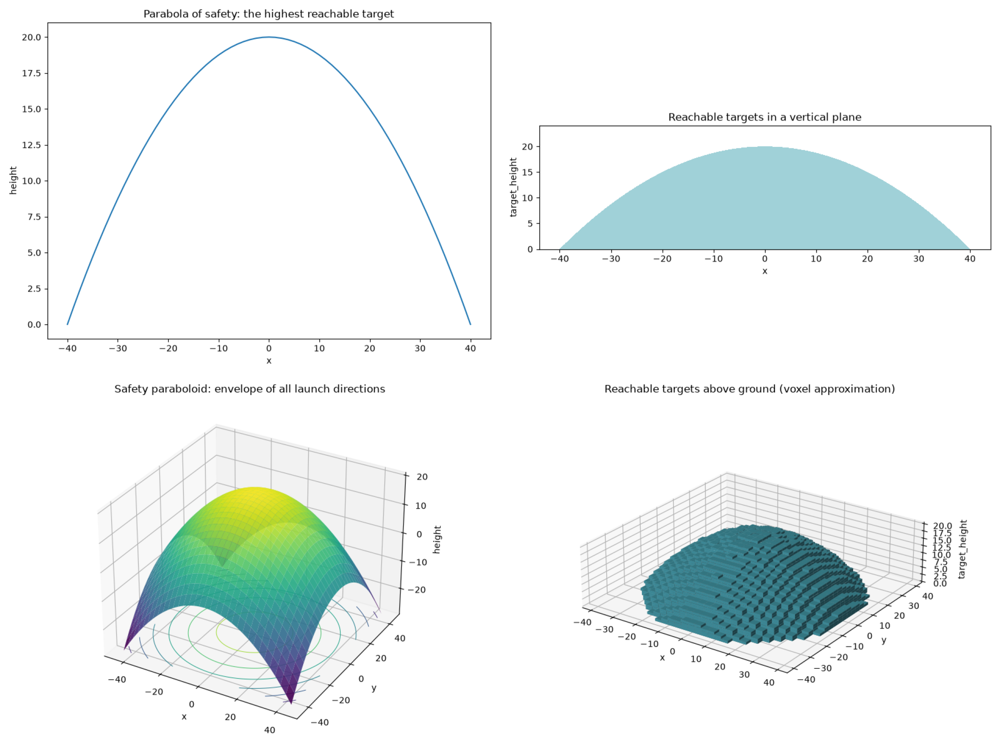

Bound a prediction from an uncertain observation
=================================================

A recorded execution cost may be known only within a range. Instead of choosing
a fitted parameter, keep every parameter consistent with that observation and
carry the resulting uncertainty into a planned execution. This small example
explores solution families; its linear impact law is illustrative.

Define an execution's mathematics once:

.. literalinclude:: ../../../examples/solution_families.py
   :pyobject: Execution

Join two executions through the same impact coefficient:

.. literalinclude:: ../../../examples/solution_families.py
   :start-at: class ImpactStudy
   :end-before:     @classmethod

Fix the quantities, reference prices, and fees. Impact remains unknown:

.. literalinclude:: ../../../examples/solution_families.py
   :pyobject: ImpactStudy.prepare

>>> from examples.solution_families import ImpactStudy
>>> problem = ImpactStudy.prepare()
>>> study = problem.symbols
>>> family = problem.solutions(study.impact)

Keep impact as the exploration coordinate. Constrain the recorded cost to its
observed interval, then ask what that means for the planned trade:

>>> calibrated = family.where(study.recorded.cost >= 200, study.recorded.cost <= 202)
>>> calibrated.values(study.impact)
Interval(1/4, 3/4)

The joining model carries the calibration into the prediction through one
shared quantity. ``ImpactStudy.calibrated()`` packages these preparation and
observation steps into a prediction that is ready to query:

>>> prediction = ImpactStudy.calibrated()
>>> prediction.values(prediction.symbols.planned.cost)
Interval(1026, 1076)
>>> prediction.expression(prediction.symbols.planned.cost) == 100 * prediction.symbols.impact + 1001
True

There is no statistical confidence level attached to this interval; it follows
from the specified bounds and the model's assumptions.

Select a particular impact to obtain a normal typed model:

>>> from sympy import Rational
>>> case = prediction.observe(impact=Rational(1, 2)).one()
>>> case.recorded.cost, case.planned.cost
(201, 1051)
>>> case.recorded.impact == case.planned.impact
True

Plot the same expression over its admissible interval with
``ImpactStudy.plot(prediction, Path("cost.png"))``. From a checkout, the
notebook dependency group supplies the optional Matplotlib backend:

.. code-block:: console

   $ uv run --group notebooks python -m examples.solution_families --plot cost.png

Running ``python -m examples.solution_families`` prints the intervals with only
the library's existing SymPy dependency. The plot is a view of the bounded
family; numerical plotting does not establish additional guarantees.

.. image:: impact-cost.png
   :alt: Planned execution cost increases from 1026 to 1076 as impact varies from one quarter to three quarters.

Discover where a projectile can reach
-------------------------------------

A thrown ball gives familiar, nonlinear geometry from one physical model.
Assume uniform gravity and no air resistance. ``FreeFlight`` describes where
it would be at the same time without gravity: ``x, y`` are horizontal and
``z`` is vertical. At a fixed speed, squared distance determines squared
travel time. ``Projectile`` subtracts the gravitational drop:

.. literalinclude:: ../../../examples/projectile.py
   :start-at: class FreeFlight
   :end-before:     @classmethod

Fix launch speed at 20 m/s and gravity at 10 m/s², leaving destinations unknown:

>>> from examples.projectile import FreeFlight, Projectile
>>> from sympy import Eq, FiniteSet, diff, factor
>>> problem = Projectile.prepare()
>>> flight = problem.symbols
>>> family = problem.solutions(flight.x, flight.y, flight.free.z, flight.target_height)

First solve backwards: which launch directions reach a target 16 metres
away and 16 metres high? Both a lower and a higher throw satisfy the same model:

>>> hits = family.observe(x=16, y=0, target_height=16).where(Eq(flight.clearance, 0))
>>> hits.values(flight.free.z) == FiniteSet(32, 48)
True
>>> len(hits.cases())
2

To find the boundary of all reachable targets, expand the height expression
before differentiating its vertical free-flight coordinate. Varying that
coordinate changes launch direction and travel time while holding the
horizontal destination fixed:

>>> height = family.expression(flight.height)
>>> stationary = diff(height, flight.free.z)
>>> envelope = family.where(Eq(stationary, 0))

SymPy derives the maximum reachable height at every horizontal location:

>>> ceiling = envelope.expression(flight.height)
>>> ceiling == 20 - flight.x**2 / 80 - flight.y**2 / 80
True
>>> factor(ceiling - height) == (flight.free.z - 40)**2 / 80
True

The nonnegative square proves this is a global maximum, rather than merely a
stationary point. This **trajectory envelope** bounds a family of throws; it
is not itself one ball's trajectory. ``Projectile.envelope()`` packages these
same derivation steps, without introducing another height formula.

Take sections through a typed reference. With sideways displacement zero,
the envelope is the **parabola of safety**:

>>> reference = envelope.observe(x=0, y=0, target_height=0).one()
>>> curve = envelope.section(flight.x, through=reference)
>>> curve.expression(flight.height) == 20 - flight.x**2 / 80
True

Instead, vary horizontal distance and target height. Keeping targets above
ground and below the envelope selects the **reachable area** in that plane:

>>> plane = envelope.section(flight.x, flight.target_height, through=reference)
>>> area = plane.where(flight.target_height >= 0, flight.clearance >= 0)

Allow both horizontal coordinates to vary for the **safety paraboloid**.
Allow target height to vary too, under the same constraints, for the
**reachable volume**:

>>> surface = envelope.section(flight.x, flight.y, through=reference)
>>> volume = envelope.where(flight.target_height >= 0, flight.clearance >= 0)

   One motion model supplies a curve, area, surface, and volume. The volume
   uses occupied voxel centres; cells may cross the exact boundary. The
   surface also shows its continuation below ground.

A surface has two independent controls even though its scalar height response
has a one-dimensional image. Include the coordinates when measuring its graph:

>>> from examples.solution_views import ModelView
>>> view = ModelView(surface.parameters, surface)
>>> view.control_dimension, view.image_dimension(flight.x, flight.y, flight.height)
(2, 2)

``ModelViews.sections()`` lazily enumerates coordinate sections through the
reference. Export these four named views with optional notebook dependencies:

.. code-block:: console

   $ uv run --group notebooks python -m examples.solution_views --plot-dir views

Open ``views/index.html``. ``ModelView.plot(...)`` draws polynomial responses;
``plot_region(...)`` draws planar implicit sets or approximates spatial
inequality regions. Both take typed ``lower`` and ``upper`` models as windows.
Numerical pictures do not establish dimensions or exact boundaries.

Dimension reporting covers real interval boxes and finite point sets;
polynomial image dimension uses exact rational-function Jacobian rank
(`Geiger et al., Lemma 9 and Theorem 10 <https://doi.org/10.1214/aos/1009210550>`_).
Coupled domains remain ``None`` even when their geometry looks clear. These
constraints still define exact sets when SymPy retains a ``ConditionSet``.
To explore a supplied input, prepare a new problem leaving it unknown;
observations add constraints rather than unpinning existing inputs.

The equations follow `OpenStax's projectile motion model <https://openstax.org/books/university-physics-volume-1/pages/4-3-projectile-motion>`_.
The gravity-free coordinates and envelope construction follow
`Mark Levi's Parabola of Safety and the Jacobian <https://www.siam.org/publications/siam-news/articles/parabola-of-safety-and-the-jacobian/>`_.
