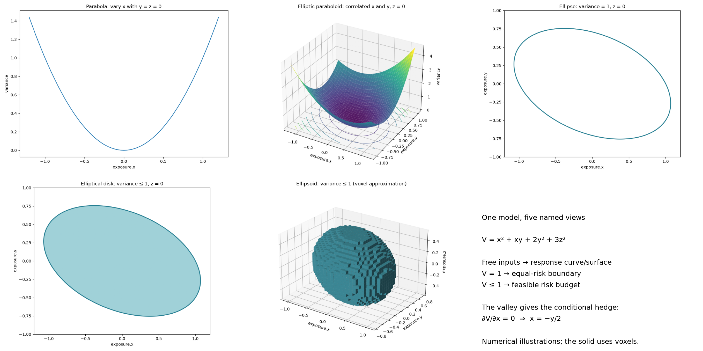

Bound a prediction from an uncertain observation
=================================================

A recorded execution cost may be known only within a range. Instead of choosing
a fitted parameter, keep every parameter consistent with that observation and
carry the resulting uncertainty into a planned execution. This small example
explores solution families; its linear impact law is illustrative.

Define an execution's mathematics once:

.. literalinclude:: ../../../examples/solution_families.py
   :pyobject: Execution

Join two executions through the same impact coefficient:

.. literalinclude:: ../../../examples/solution_families.py
   :start-at: class ImpactStudy
   :end-before:     @classmethod

Fix the quantities, reference prices, and fees. Impact remains unknown:

.. literalinclude:: ../../../examples/solution_families.py
   :pyobject: ImpactStudy.prepare

>>> from examples.solution_families import ImpactStudy
>>> problem = ImpactStudy.prepare()
>>> study = problem.symbols
>>> family = problem.solutions(study.impact)

Keep impact as the exploration coordinate. Constrain the recorded cost to its
observed interval, then ask what that means for the planned trade:

>>> calibrated = family.where(study.recorded.cost >= 200, study.recorded.cost <= 202)
>>> calibrated.values(study.impact)
Interval(1/4, 3/4)

The joining model carries the calibration into the prediction through one
shared quantity. ``ImpactStudy.calibrated()`` packages these preparation and
observation steps into a prediction that is ready to query:

>>> prediction = ImpactStudy.calibrated()
>>> prediction.values(prediction.symbols.planned.cost)
Interval(1026, 1076)
>>> prediction.expression(prediction.symbols.planned.cost) == 100 * prediction.symbols.impact + 1001
True

There is no statistical confidence level attached to this interval; it follows
from the specified bounds and the model's assumptions.

Select a particular impact to obtain a normal typed model:

>>> from sympy import Rational
>>> case = prediction.observe(impact=Rational(1, 2)).one()
>>> case.recorded.cost, case.planned.cost
(201, 1051)
>>> case.recorded.impact == case.planned.impact
True

Plot the same expression over its admissible interval with
``ImpactStudy.plot(prediction, Path("cost.png"))``. From a checkout, the
notebook dependency group supplies the optional Matplotlib backend:

.. code-block:: console

   $ uv run --group notebooks python -m examples.solution_families --plot cost.png

Running ``python -m examples.solution_families`` prints the intervals with only
the library's existing SymPy dependency. The plot is a view of the bounded
family; numerical plotting does not establish additional guarantees.

.. image:: impact-cost.png
   :alt: Planned execution cost increases from 1026 to 1076 as impact varies from one quarter to three quarters.

Discover named risk views
-------------------------

   The same equations viewed through free inputs, an equal-risk constraint,
   and a risk budget. The solid is a voxel approximation.

A quadratic risk model gives more revealing geometry. Define signed exposures,
their variance, and a component layer naming a common risk level:

.. literalinclude:: ../../../examples/solution_families.py
   :start-at: class Exposure
   :end-before: class ImpactStudy

Leave the exposures unknown, then take sections through a typed reference:

>>> from modello import inspect_model
>>> from examples.solution_families import Exposure, Risk, IsoRisk
>>> from examples.solution_views import ModelViews
>>> problem = inspect_model(Risk, "risk views")
>>> risk = problem.symbols
>>> family = problem.solutions(risk.exposure.x, risk.exposure.y, risk.exposure.z)
>>> reference = Risk("zero risk", exposure=Exposure("zero exposures", x=0, y=0, z=0))
>>> curve = family.section(risk.exposure.x, through=reference)
>>> curve.expression(risk.variance) == risk.exposure.x**2
True

Varying ``x`` traces a **parabola**; varying ``x, y`` traces an **elliptic
paraboloid**. ``ModelViews.sections()`` lazily enumerates all seven combinations
of these three controls. A scalar response still has only one image dimension:

>>> whole = tuple(ModelViews(family, through=reference).sections())[-1]
>>> whole.control_dimension, whole.image_dimension(risk.variance)
(3, 1)

The named ``IsoRisk`` layer selects a different view: supply its level while
leaving its nested exposures unknown. At level one, the solutions form an
**ellipsoid boundary**:

>>> from sympy import Eq, Tuple, diff
>>> unit = inspect_model(IsoRisk, "unit risk", level=1)
>>> contour = unit.solutions()
>>> exposure = unit.symbols.risk.exposure
>>> contour.values(exposure.x, exposure.y, exposure.z).contains(Tuple(1, 0, 0))
True

An inequality retains the interior too: ``variance <= 1`` gives an **ellipsoidal
risk-budget region**. Fixing ``z=0`` cuts an **elliptical disk**; equality instead
of inequality gives its ellipse boundary:

>>> budget = family.where(risk.variance <= 1)
>>> disk = budget.where(Eq(risk.exposure.z, 0))
>>> disk.values(risk.exposure.x, risk.exposure.y).contains(Tuple(0, 0))
True
>>> disk.values(risk.exposure.x, risk.exposure.y).contains(Tuple(2, 0))
False

The same expression reveals a **conditional minimum-risk hedge**. Constrain its
``x`` sensitivity to zero; SymPy supplies the relationship, rather than a second
implementation of the risk model:

>>> variance = family.expression(risk.variance)
>>> hedged = family.where(Eq(diff(variance, risk.exposure.x), 0))
>>> hedged.expression(risk.exposure.x) == -risk.exposure.y / 2
True
>>> hedged.expression(risk.variance) == 7 * risk.exposure.y**2 / 4 + 3 * risk.exposure.z**2
True

Its second derivative in ``x`` is positive, so this is the unique minimum for
each fixed ``y, z``. The cross term makes opposite exposures partly offset one
another; the hedge appears as the valley through the risk surface.

Export the story with the optional notebook dependencies:

.. code-block:: console

   $ uv run --group notebooks python -m examples.solution_views --plot-dir views

Open ``views/index.html`` for the parabola, paraboloid, ellipse, filled disk,
and ellipsoidal budget. ``ModelView.plot(response, ...)`` draws a response over
box controls; ``plot_region(...)`` uses
`SymPy's implicit plotting data <https://docs.sympy.org/latest/modules/plotting.html#sympy.plotting.series.ImplicitSeries.get_data>`_
for two-control sets, or approximates a three-control inequality region with
voxels, whose cells can cross the boundary. Both take
typed ``lower`` and ``upper`` models for their sampling windows. Three-control
equality surfaces are not supported by this renderer.

These constraints define exact solution sets even when SymPy retains a
``ConditionSet``. Numerical pictures do not certify their dimensions. Dimension
reporting covers real interval boxes and finite point sets; polynomial image
dimension uses an exact rational-function Jacobian rank
(`Geiger et al., Lemma 9 and Theorem 10 <https://doi.org/10.1214/aos/1009210550>`_).
Coupled domains remain ``None``: three coordinates can describe an ellipsoid's
two-dimensional boundary. To explore an already supplied input, prepare a new
problem leaving it unknown; observations add constraints rather than unpinning
existing inputs.
