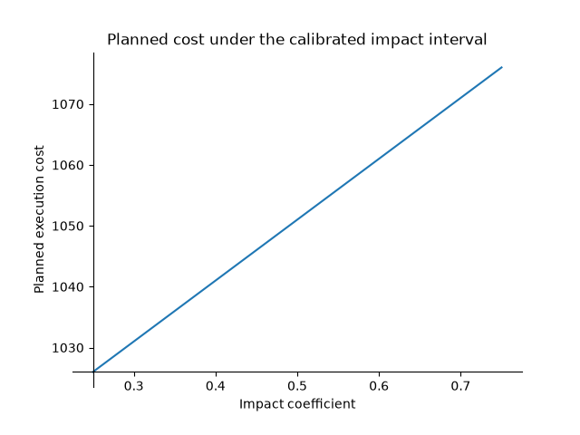

Bound a prediction from an uncertain observation
=================================================

A recorded execution cost may be known only within a range. Instead of choosing
a fitted parameter, keep every parameter consistent with that observation and
carry the resulting uncertainty into a planned execution. This small example
explores solution families; its linear impact law is illustrative.

Define an execution's mathematics once:

.. literalinclude:: ../../../examples/solution_families.py
   :pyobject: Execution

Join two executions through the same impact coefficient:

.. literalinclude:: ../../../examples/solution_families.py
   :start-at: class ImpactStudy
   :end-before:     @classmethod

Fix the quantities, reference prices, and fees. Impact remains unknown:

.. literalinclude:: ../../../examples/solution_families.py
   :pyobject: ImpactStudy.prepare

>>> from examples.solution_families import ImpactStudy
>>> problem = ImpactStudy.prepare()
>>> study = problem.symbols
>>> family = problem.solutions(study.impact)

Keep impact as the exploration coordinate. Constrain the recorded cost to its
observed interval, then ask what that means for the planned trade:

>>> calibrated = family.where(study.recorded.cost >= 200, study.recorded.cost <= 202)
>>> calibrated.values(study.impact)
Interval(1/4, 3/4)
>>> calibrated.values(study.planned.cost)
Interval(1026, 1076)
>>> calibrated.expression(study.planned.cost) == 100 * study.impact + 1001
True

The joining model carries the calibration into the prediction through one
shared quantity. ``ImpactStudy.calibrated()`` packages these preparation and
observation steps. There is no statistical confidence level attached to this
interval; it follows from the specified bounds and the model's assumptions.

Select a particular impact to obtain a normal typed model:

>>> from sympy import Rational
>>> case = calibrated.observe(impact=Rational(1, 2)).one()
>>> case.recorded.cost, case.planned.cost
(201, 1051)
>>> case.recorded.impact == case.planned.impact
True

Plot the same expression over its admissible interval with
``ImpactStudy.plot(calibrated, Path("cost.png"))``. From a checkout, the
notebook dependency group supplies the optional Matplotlib backend:

.. code-block:: console

   $ uv run --group notebooks python -m examples.solution_families --plot cost.png

Running ``python -m examples.solution_families`` prints the intervals with only
the library's existing SymPy dependency. The plot is a view of the bounded
family; numerical plotting does not establish additional guarantees.

See :doc:`/solutions` for refinement, coupled projections, exception handling,
and the current scope of the exploration API.
