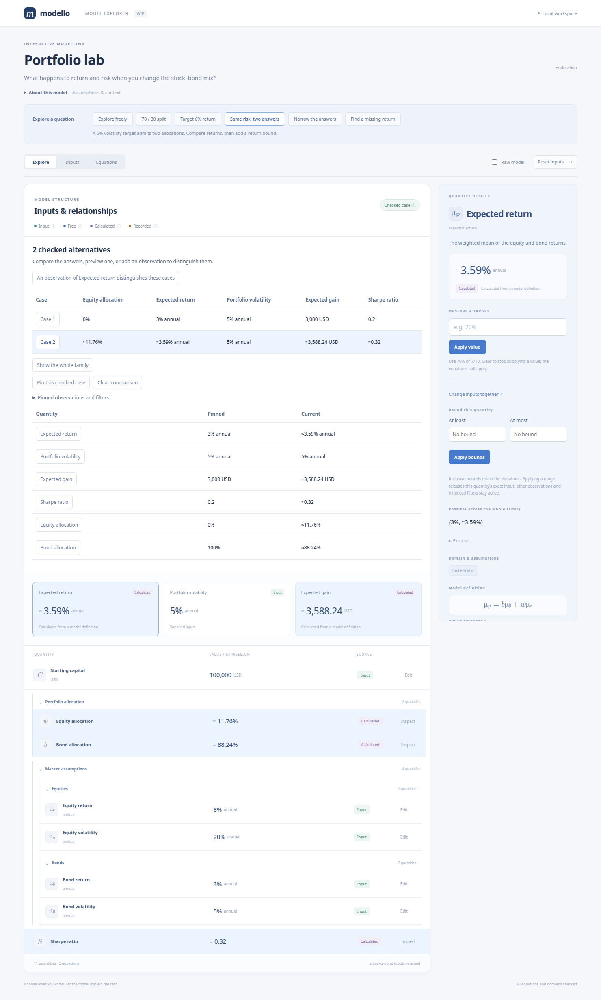
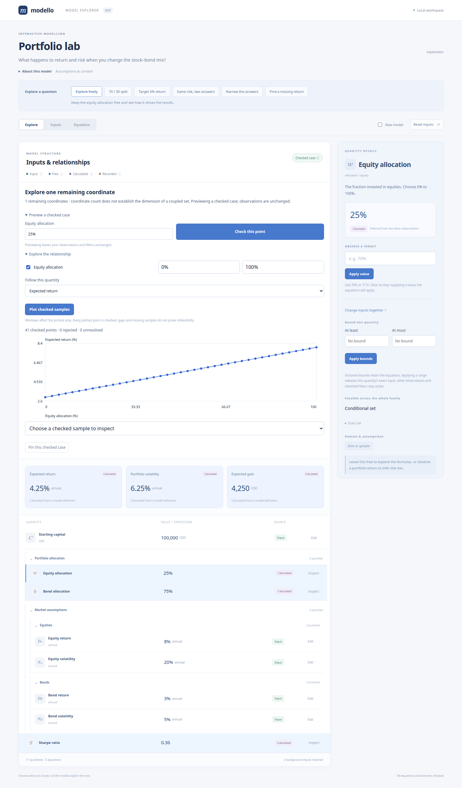
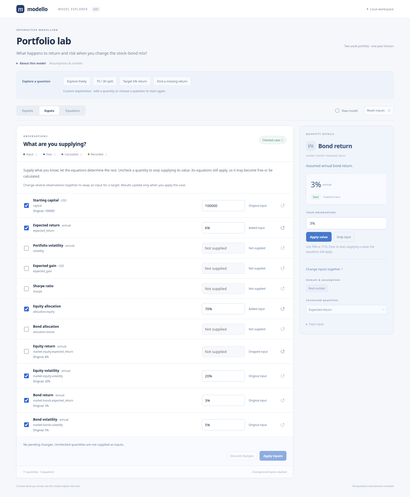
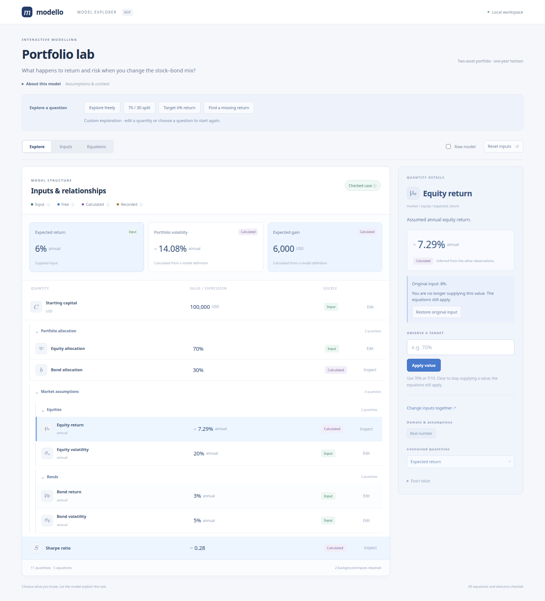
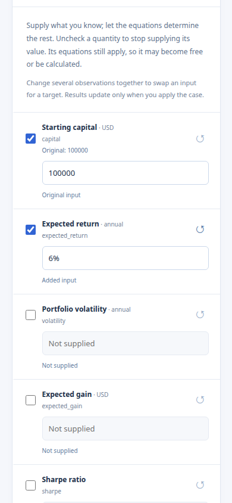

Interactive model explorer (WIP)
================================

The optional :mod:`modello.gui` module renders nested models in a local browser.
Install its separate extra; the base library still depends only on SymPy:

.. code-block:: console

   $ pip install 'modello[gui]'
   $ python -m examples.gui

From a checkout, use ``uv run --extra gui python -m examples.gui``. Open
http://127.0.0.1:5058.

Quickstart: your own explorer
------------------------------

Save this complete example as ``return_model.py`` and run
``python return_model.py`` after installing ``modello[gui]``. Open
http://127.0.0.1:5058. From a checkout, the same example runs with
``uv run --extra gui python -m examples.gui_quickstart``.

.. literalinclude:: ../examples/gui_quickstart.py
   :language: python
   :start-at: from sympy import Rational

Capital starts as a supplied input and expected return starts free. Choose
**8% return** to calculate USD 8,000 expected gain. Change capital to USD 200,000
to see gain update to USD 16,000. Drop the return input to explore the formula
again, or supply a gain instead to infer the required return.

Plain model declarations work without presentation metadata. Add ``gui`` where
labels, descriptions, symbols, or display formats help. ``@ModelInfo`` adds the
model's text and optional guided questions. Only serving the browser requires
the GUI extra; core annotations and Python snapshots work without Flask.

A portfolio to explore
----------------------

The demo is a familiar two-asset mean–variance portfolio. Equity and bond
assumptions live in nested components, and allocation weights must be
non-negative and sum to 100%. It starts with the equity allocation **free**,
so the results remain expressions in that unknown.

The illustrative annual inputs are 8% equity return with 20% volatility and
3% bond return with 5% volatility, on USD 100,000 of starting capital.
Zero return correlation and a 2% risk-free rate are retained as background
inputs. These are supplied assumptions, not estimates from market data.

For equity weight :math:`w` and bond weight :math:`b`, the model relates:

.. math::

   b &= 1-w, \\
   \mu_p &= w\mu_e + b\mu_b, \\
   \sigma_p &= \sqrt{w^2\sigma_e^2+b^2\sigma_b^2+2wb\rho\sigma_e\sigma_b}, \\
   G &= C\mu_p, \qquad S = \frac{\mu_p-r_f}{\sigma_p}.

The weighted mean and covariance-based variance follow the standard
`mean–variance formulation in the CVX short course
<https://www.cvxgrp.org/cvx_short_course/docs/applications/notebooks/portfolio_optimization.html>`_.
The demo evaluates and inverts these relationships; it does not optimise an
allocation or estimate return statistics.

.. image:: _static/gui/partial.png
   :alt: An open equity allocation drives typeset symbolic portfolio results.

Use the guided questions to see different ways to bind the same model:

* **Explore freely** retains the assumptions and leaves the allocation open.
* **70 / 30 split** supplies a 70% equity allocation. The expected return is
  6.5%, volatility is approximately 14.08%, and expected gain is USD 6,500.
* **Target 6% return** observes a result instead of an input. The equations
  infer a 60% equity / 40% bond mix and USD 6,000 expected gain.
* **Same risk, two answers** observes 5% volatility. Both 0% equity and
  :math:`2/17` equity satisfy it, with different expected returns.
* **Narrow the answers** keeps that risk target and adds a 3.5% minimum
  expected return. Only the :math:`2/17` equity allocation remains.
* **Find a missing return** supplies a 70/30 mix, drops the original equity
  return assumption, and observes a 6% portfolio return. The equations infer
  an equity return of approximately 7.29%.

Each question restores the initial inputs before applying its observations.
Subsequent edits are marked as a custom exploration. Inspect a quantity,
enter a value, and choose **Apply value** or press Enter. **Drop input**
removes a supplied observation; clearing the editor does the same.
Try a 120% equity allocation to see an **Empty family**: its derived bond
weight violates the non-negative domain. The observations remain visible so
you can inspect the failing domain and revise the question.

.. image:: _static/gui/explore.png
   :alt: A checked 70/30 case with calculated outputs and a mathematical risk definition in the inspector.

.. image:: _static/gui/inverse.png
   :alt: A return target is marked as an input while the allocation is inferred.

Choosing what you know
----------------------

An input is a supplied observation, not a permanent role assigned to a field.
You can change an original input, drop it, or supply a normally calculated
result as a target. Dropping an observation keeps the defining equations:
the quantity may become free, or it may be inferred from other observations.
Supplying a target adds an observation; it does not replace its equation or
silently discard conflicting inputs.

The **Inputs** view makes this choice explicit. Checked quantities are supplied;
unchecked quantities are left to the model. Edit values, uncheck assumptions,
or check a result and enter its target. **Apply inputs** validates all pending
changes together. The results continue to show the last applied case until
then. Malformed values and directly invalid scalar inputs preserve both those
results and the pending changes. A valid question with no feasible answers is
applied as an empty family.
**Discard changes** returns the draft to the applied case without solving.
The apply controls stay visible while you scroll through pending changes.

The view distinguishes Original, Changed, Added, and Dropped inputs. Each row
shows its original supplied value when there was one. Its reset arrow restores
that quantity's original input state in the draft; it does not reset other
quantities. Aliases share one observation and one row. Hidden inputs remain
active and have no checkbox or editor.

Useful stories to try:

* **Compare an assumption.** Start with **70 / 30 split**. Change bond return
  from 3% to 4%: portfolio return becomes 6.8%. **Restore original input** in
  its inspector returns to 6.5%, retaining the 70/30 allocation. This restores
  only the selected assumption; **Reset inputs** restores the entire initial
  model instead.
* **Stop assuming a value.** Drop the equity return input in the same 70/30
  case. Equity return becomes free and portfolio return becomes an expression.
  You can explore this partly specified model without choosing a replacement.
* **Solve for a missing assumption.** In **Inputs**, uncheck equity return,
  check expected portfolio return, enter ``6%``, and apply them together.
  Equity return is now approximately 7.29% and labelled Calculated, with its
  original 8% explicitly marked as a Dropped input. The guided question
  **Find a missing return** sets up exactly this case.
* **Return to forward calculation.** From that case, restore the equity
  return with its row's reset arrow and uncheck the portfolio return target.
  Apply both changes together: the original 8% assumption again produces a
  6.5% portfolio return, with the 70/30 allocation retained.

Keeping both the original 8% equity return and a 6% portfolio return target
with the 70/30 allocation is contradictory. The empty family retains those
observations for inspection. Changing several observations together avoids
passing through that contradictory intermediate case.

From a question to its possible answers
----------------------------------------

The family panel adapts to the reduced model, after observations and aliases
have been accounted for:

* One closed, audited state is a **checked answer**.
* A small explicit finite family shows **checked alternatives** side by side.
  Choose a case to inspect its values. The whole family and all filters remain
  available; the preview does not turn its coordinates into supplied inputs.
* One remaining coordinate offers a response curve. Two offer a joint sample
  view, with the selected output encoded by point darkness.
* With more coordinates, preview a checked reference case and choose one or
  two controls. The other coordinates stay at the reference, producing a
  **section**, with those fixed values stated beside the plot.
* An established empty family shows no feasible answer. An unresolved audit
  or implicit set retains its expressions and conditions without claiming
  existence, uniqueness, or infeasibility.

Coordinate count is not a dimension certificate. Two coordinates can still
be coupled by an equality or discrete restrictions. Finite alternatives take
priority over coordinate-based plots. At most 32 finite coordinate proposals
are materialised automatically; larger finite families need further narrowing
or an explicit point preview.

Select **Same risk, two answers**, inspect **Case 1**, and choose **Pin this
checked case**. Inspect **Case 2** to compare it with the pinned case. The
comparison includes changed quantities and highlighted outputs; the pinned
observations and filters remain inspectable. Pinning does not change the model.
The comparison belongs to the current browser session and is cleared on reload.

For finite checked alternatives, the panel suggests quantities whose observed
values would distinguish them. It prefers highlighted outputs and avoids
repeating suggestions that separate the same groups of cases. Highlighted
outputs independent of the remaining coordinates are identified separately.
These statements follow from the equations and audited cases; they do not
assign probabilities or rank explanations by likelihood.

In a quantity's inspector, **At least** and **At most** add inclusive bounds.
Either endpoint may be omitted. **Apply bounds** releases an exact input for
that quantity and retains every other observation, definition, and filter.
**Remove bounds** removes only those browser-added bounds. Recorded observations
cannot be replaced or released: bounding a Recorded quantity intersects its
existing restrictions. An incompatible bound produces an empty family.
Aliases share their bounds, just as they share observations.

**Possible across the whole family** keeps intervals, discrete alternatives,
and disconnected unions distinct. **Exact set** retains implicit sets and
conditions too. While inspecting one checked case, these sets continue to
describe the surrounding family.

Plot windows are display choices. Finite enclosing coordinate bounds seed the
window where available; unbounded coordinates require explicit endpoints.
Every plotted point is audited against all equations, assumptions, and family
filters. Selecting a point, including through the keyboard-accessible sample
picker, opens a checked preview in the original family. One-coordinate plots
retain gaps at rejected or undecided samples. Two-coordinate plots show points
without filling cells or claiming an exact region boundary. Empty samples do
not establish an empty family, and pictures do not establish global extrema.

Further runnable questions use the same existing example equations:

.. code-block:: console

   $ python -m examples.gui --demo calibration
   $ python -m examples.gui --demo reachability

The calibration starts with recorded cost in [200, 202], shared impact in
[1/4, 3/4], and planned cost in [1026, 1076]. The reachability model retains a
coupled set over forward distance, sideways distance, and target height.
Preview (0, 0, 0), then take a one- or two-coordinate section through that case.
For one-coordinate families, constant exact derivatives can also relate
quantities with matching display units. The calibration explains that each
1 USD change in recorded cost corresponds to 25 USD in planned cost. Nonlinear
or unresolved derivatives are not promoted to a constant response relationship.

Understanding the interface
---------------------------

The colour key describes the **source** of a quantity, independently of whether
its current value is numeric or symbolic:

* **Input** is a supplied observation. It can be edited or released.
* **Free** is an open quantity still represented by its own symbol.
* **Calculated** follows from the model's equations. A numeric result stays
  calculated and updates when its inputs change. A result can also be observed
  as a target, making it an input instead.
* **Recorded** is a copied component result retained in a recorded problem.
  Its editor is disabled because that observation is held in the snapshot.

Hover or focus a colour key to read its explanation. Touch users can tap a key;
tap elsewhere or press Escape to dismiss it. The case-status key also explains
the distinction between a symbolic preview and a checked numerical case.
Colour is accompanied by text labels throughout.

.. image:: _static/gui/legend.png
   :alt: The Calculated colour key explains that results recompute and may remain symbolic.

The inspector shows descriptions, units, source, domain chips, mathematical
definitions, and links to connected quantities. Expressions use native MathML
instead of printed Python or diagnostic constraint lines. Open **View in
equations** for a definition that needs more room. Numeric displays use compact
rounded values; an approximation sign marks rounding, and **Exact value**
retains the underlying expression in the displayed units.

**Raw model** shows definitions without invoking the solver, retaining recorded
inputs in the editor. **Equations** shows the original defining equations before
observations are substituted. Hover, focus, or tap a symbol to inspect its path
and description. Tab, Enter, and Space support keyboard exploration.

On narrow screens the inspector moves below the model. Selecting a quantity
brings its details into view; **Back to model** returns to the quantities.
Tooltip placement is clamped to the viewport.

.. image:: _static/gui/equations.png
   :alt: Original portfolio definitions rendered as MathML with a field inspector.

.. image:: _static/gui/mobile.png
   :width: 260px
   :alt: The portfolio demo and guided questions in a narrow mobile viewport.

.. image:: _static/gui/mobile-inspector.png
   :width: 260px
   :alt: The mobile inspector shows a percentage editor, domain, and connected quantities.

Starting from your model
------------------------

``create_app`` accepts a model class, an existing instance, a recorded
:class:`~modello.diagnostics.ModelProblem`, or a
:class:`~modello.solutions.SolutionFamily`. Initial inputs use full dotted paths:

.. code-block:: python

   from modello.gui import create_app
   from examples.gui import Portfolio, DEMO_INPUTS

   app = create_app(Portfolio, "My portfolio", inputs=DEMO_INPUTS)
   app.run(host="127.0.0.1", port=5058, debug=False)

With an instance, original inputs are reopened as observations and solved
outputs are recomputed when inputs change. An overwritten instance field
becomes an input, as with component copies. The source instance is never
mutated. With a recorded problem, all its constraints remain, including
inferred component observations. Those are labelled Recorded and held fixed.
Reopen the instance when you want its outputs to recompute from original inputs.
Each browser holds its own edits and cannot change another browser's state.

Pass the family itself to retain ``where(...)`` filters, preferred coordinates,
and any section conditions. A model instance selected with ``one()`` contains
its observations and values, but does not retain the originating family's
inequalities or section context:

>>> from examples.solution_families import ImpactStudy
>>> from modello.gui import Explorer
>>> from sympy import Rational
>>> explorer = Explorer(ImpactStudy.calibrated())
>>> initial = explorer.snapshot()
>>> initial["exploration"]["coordinate_count"]
1
>>> preview = explorer.snapshot(point={"impact": Rational(1, 2)})
>>> preview["status"], preview["exploration"]["coordinate_count"]
('checked', 1)
>>> next(field["value"] for field in preview["fields"] if field["path"] == "planned.cost")
'1051'
>>> chart = explorer.plot(controls=["impact"], output="planned.cost", windows={"impact": (Rational(1, 4), Rational(3, 4))})
>>> len(chart["points"]), chart["unknown"]
(41, 0)

Descriptions, units, and guided questions
-----------------------------------------

Place presentation beside a field with ``gui(field, *, ...)``, as in the
quickstart. All metadata arguments are keyword-only, including direct
``FieldInfo(...)``, ``ModelInfo(...)``, and ``Scenario(...)`` construction.
``gui`` accepts an ``InstanceDummy``, a calculated expression, or
``component(Child)``. Decorate the class with ``@ModelInfo(...)`` for model-level
text and guided questions.

Use ``gui`` around the **entire value assigned inside a Modello class body**:
``gain = gui(capital * expected_return, title="Expected gain")``. The class
namespace unwraps the declaration before later expressions use the field
normally. This declaration helper is not an arithmetic wrapper; putting
``gui(capital, ...)`` inside a larger calculation, or using its return value
outside that class scope, leaves the declaration uncollected.

Field metadata is a :class:`FieldInfo` annotation. The core collects it through
the general :class:`~modello.Annotation` mechanism; the solver never receives
GUI wrappers or metadata. Registry lookups are independent of Flask:

.. code-block:: python

   from modello.gui import FieldInfo

   info = ReturnModel.__modello_annotations__[FieldInfo]["expected_return"]
   assert info.title == "Expected return"
   # A typed helper for extension consumers:
   assert FieldInfo.for_model(ReturnModel)["expected_return"].symbol == "μ"
   assert ModelInfo.for_model(ReturnModel)[""].title == "Return model"

Nested annotation paths are scoped automatically, such as
``"market.equity.expected_return"``. Components retain their own declarations;
``gui(component(Child), ...)`` labels that component in its parent. Class
docstrings supply default model and component descriptions. Model classes and
component instance types are preserved. See :ref:`extension-annotations` for
writing other extensions using the same registry.

For models declared elsewhere, a ``ModelInfo(fields=...)`` mapping can override
presentation by relative dotted path. Application-level ``metadata=`` overrides
take priority over that mapping, followed by inline annotations. Each override
replaces the whole ``FieldInfo`` for that path. Model presentation uses the
annotation registry; ``__gui__`` blocks are rejected with a migration hint.
Presentation never changes the algebra.

``highlights`` makes selected quantities prominent as result cards.
``initial_field`` chooses the first inspector selection. A ``Scenario`` contains
trusted scalar observations and an optional field to select. Paths and edit
permissions are validated; a scenario cannot change hidden or Recorded values.
Its observations still pass through the same validation as manual edits.
Use ``None`` in a scenario's bindings to drop a specific initial observation;
other initial observations remain active.
``Scenario(bounds={"expected_return": (Rational(7, 200), None)}, ...)``
adds a lower bound. Guided questions restore initial observations and replace
browser-added bounds; they retain any filters on a supplied source family.
Presentation paths are checked when constructing ``Explorer`` or ``create_app``,
before serving any requests. Errors name the offending option or scenario,
include the full nested path, and suggest similar field names when available.
For example, a misspelt ``Scenario(title="Target", ...,
select="expected_retrn")`` reports ``Scenario 'Target'.select`` and suggests
``'expected_return'``. Initial input paths and snapshot bindings use the same
path checks. A scenario targeting hidden or Recorded data explains why the
quantity cannot be edited.

Repeating ``gui`` metadata on the same field or
``ModelInfo`` on the same class raises ``ModelDefinitionError``; subclasses
can explicitly refine inherited presentation in their own declaration scope.

``symbol`` is literal text, including Unicode, rather than LaTeX. ``unit`` is a
display label without automatic unit conversion or dimensional analysis.
``number_format="percent"`` displays fractional values in percent and seeds
the editor with percentage notation. Numeric summaries do not change exact
values or loosen validation.

A hidden field or component has no row or editor. Its original inputs remain
in every solve, and the browser cannot replace or release them, including
through aliases. Hidden observation values are omitted from the browser
response; their public symbols and descriptions remain inspectable in formulas.
This is presentation rather than a secrecy boundary: derived outputs and
public model notes can reveal inputs.

Exact edits and validation
--------------------------

Editors accept numbers, ``+``, ``-``, ``*``, ``/``, ``**``, ``sqrt(...)``, ``pi``,
``E``, and ``I``. A trailing ``%`` divides the whole expression by 100:
``70%`` and ``7/10`` are the same exact value. ``1.25`` is exactly ``5/4``.
Input length, literal and arithmetic sizes, and powers are bounded. The parser
uses Python's syntax tree without evaluating Python or SymPy expression strings.
Arbitrary functions, attribute access, and new parameter names are not accepted.
The trusted Python API continues to accept normal symbolic scalar inputs.

Proposed numerical cases are checked against original equations, all declared
assumptions, and retained family filters, including domains of calculated and
hidden quantities. Malformed values and directly invalid scalar inputs are
rejected without replacing the applied results. Infeasible combinations are
shown as empty families, with known substituted domain failures available for
inspection. No arbitrary branch or sampled point is chosen when several
solutions remain.

A unique symbolic proposal is labelled **Exploring** when its audit cannot
establish a fully checked numeric case. This includes partially bound models
and unresolved external parameters. It is not a claim that every remaining
parameter value is admissible. **Checked case** requires a closed candidate
satisfying every audit. Failure to produce a solver candidate is reported as
failure to validate a case, not as proof of inconsistency.

Scope of this draft
-------------------

The interface serves bundled HTML, CSS, JavaScript, and MathML without a CDN or
JavaScript build. The local Flask server is intended for small trusted models
on loopback. Symbolic work is synchronous; arithmetic limits are not a solver
timeout. There is no deployment, authentication, persistence,
or model-instance export flow. Case previews and pinned comparisons are kept
in browser memory. Plotting explicitly checks a bounded sample of 41 points for
one control or 11 by 11 for two; it does not continuously solve while dragging.

The GUI explores the exact solution family and uses its candidate audits.
Inputs outside the family's supported exact-expression scope retain the prior
single-proposal preview, with the family limitation reported explicitly.
Ordinary construction keeps its existing solving behavior.
Python users can call ``Explorer(...).snapshot(raw=True)``
for a solver-free, JSON-ready view without installing Flask. Snapshot ``kind``
uses ``derived`` for both numeric and symbolic calculations and ``fixed`` only
for recorded component observations; ``value_state`` describes the display form.
Each visible field also reports ``initial_input`` and an ``input_state`` of
``initial``, ``overridden``, ``added``, ``dropped``, or ``unspecified``. This input
history is independent of whether the current value is free or calculated.
Hidden fields omit original values and report ``input_state="hidden"``.

Python snapshots are stateless proposals against the initial observations:
``snapshot({"height": 6})`` overrides height, and ``snapshot({"height": None})``
drops it. Omitting height from the next proposal restores its original state.
Pass all desired overrides and drops together in one mapping. The browser
retains this mapping between edits and removes a field's override when you
restore it individually.

``snapshot(bounds={path: (lower, upper)}, case=index)`` selects one checked
finite alternative without changing the observations. Alternatively,
``point={path: exact_value, ...}`` previews every remaining coordinate together.
Case indices belong to the current refinement and are reset after edits.
Bounds are stateless against the source family, so omitting them removes the
browser-added restrictions. Source-family conditions always remain active.
The ``exploration`` record reports coordinates, audited alternatives,
selection, active conditions, invariant outputs, and distinguishing quantities.
Each visible field's ``possible_values`` retains its exact set separately from
the selected point's displayed value.

API
---

.. automodule:: modello.gui
   :members: gui, ModelInfo, FieldInfo, Scenario, Explorer, BindingError, create_app
