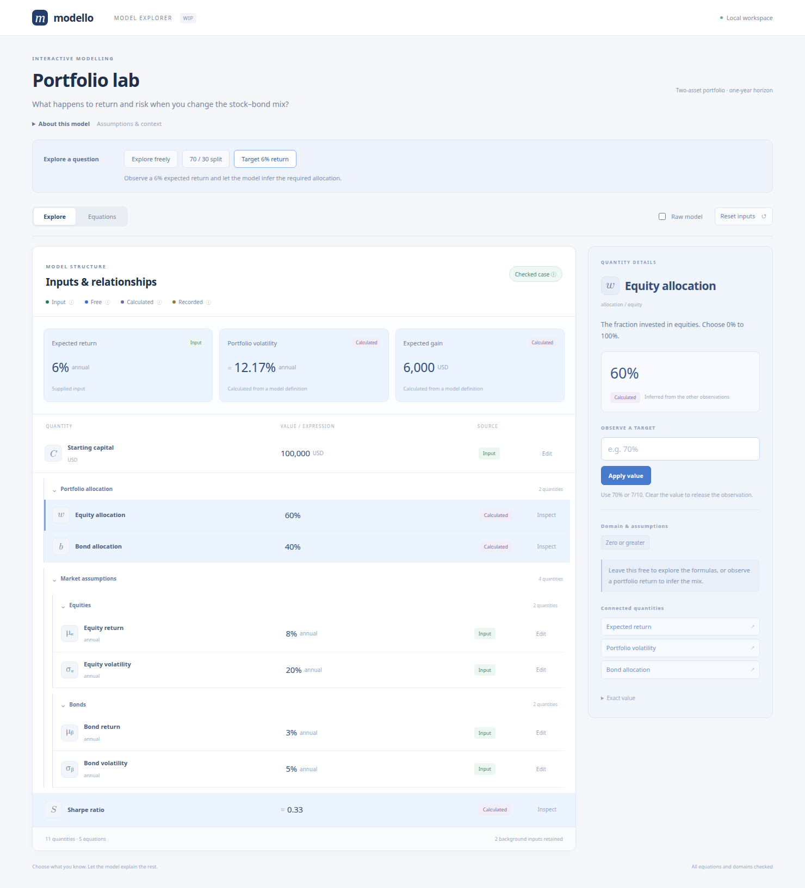

Interactive model explorer (WIP)
================================

The optional :mod:`modello.gui` module renders nested models in a local browser.
Install its separate extra; the base library still depends only on SymPy:

.. code-block:: console

   $ pip install 'modello[gui]'
   $ python -m examples.gui

From a checkout, use ``uv run --extra gui python -m examples.gui``. Open
http://127.0.0.1:5058.

A portfolio to explore
----------------------

The demo is a familiar two-asset mean–variance portfolio. Equity and bond
assumptions live in nested components, and allocation weights must be
non-negative and sum to 100%. It starts with the equity allocation **free**,
so the results remain expressions in that unknown.

The illustrative annual inputs are 8% equity return with 20% volatility and
3% bond return with 5% volatility, on USD 100,000 of starting capital.
Zero return correlation and a 2% risk-free rate are retained as background
inputs. These are supplied assumptions, not estimates from market data.

For equity weight :math:`w` and bond weight :math:`b`, the model relates:

.. math::

   b &= 1-w, \\
   \mu_p &= w\mu_e + b\mu_b, \\
   \sigma_p &= \sqrt{w^2\sigma_e^2+b^2\sigma_b^2+2wb\rho\sigma_e\sigma_b}, \\
   G &= C\mu_p, \qquad S = \frac{\mu_p-r_f}{\sigma_p}.

The weighted mean and covariance-based variance follow the standard
`mean–variance formulation in the CVX short course
<https://www.cvxgrp.org/cvx_short_course/docs/applications/notebooks/portfolio_optimization.html>`_.
The demo evaluates and inverts these relationships; it does not optimise an
allocation or estimate return statistics.

.. image:: _static/gui/partial.png
   :alt: An open equity allocation drives typeset symbolic portfolio results.

Use the guided questions to see different ways to bind the same model:

* **Explore freely** retains the assumptions and leaves the allocation open.
* **70 / 30 split** supplies a 70% equity allocation. The expected return is
  6.5%, volatility is approximately 14.08%, and expected gain is USD 6,500.
* **Target 6% return** observes a result instead of an input. The equations
  infer a 60% equity / 40% bond mix and USD 6,000 expected gain.

Each question restores the initial inputs before applying its observations.
Subsequent edits are marked as a custom exploration. Inspect a quantity,
enter a value, and choose **Apply value** or press Enter. **Release input**
removes a supplied observation; clearing the editor does the same.
Try a 120% equity allocation to see the derived bond weight violate its
non-negative domain. The change is rejected and the previous results remain.

.. image:: _static/gui/explore.png
   :alt: A checked 70/30 case with calculated outputs and a mathematical risk definition in the inspector.

Understanding the interface
---------------------------

The colour key describes the **source** of a quantity, independently of whether
its current value is numeric or symbolic:

* **Input** is a supplied observation. It can be edited or released.
* **Free** is an open quantity still represented by its own symbol.
* **Calculated** follows from the model's equations. A numeric result stays
  calculated and updates when its inputs change. A result can also be observed
  as a target, making it an input instead.
* **Recorded** is a copied component result retained in a recorded problem.
  Its editor is disabled because that observation is held in the snapshot.

Hover or focus a colour key to read its explanation. Touch users can tap a key;
tap elsewhere or press Escape to dismiss it. The case-status key also explains
the distinction between a symbolic preview and a checked numerical case.
Colour is accompanied by text labels throughout.

.. image:: _static/gui/legend.png
   :alt: The Calculated colour key explains that results recompute and may remain symbolic.

The inspector shows descriptions, units, source, domain chips, mathematical
definitions, and links to connected quantities. Expressions use native MathML
instead of printed Python or diagnostic constraint lines. Open **View in
equations** for a definition that needs more room. Numeric displays use compact
rounded values; an approximation sign marks rounding, and **Exact value**
retains the underlying expression in the displayed units.

**Raw model** shows definitions without invoking the solver, retaining recorded
inputs in the editor. **Equations** shows the original defining equations before
observations are substituted. Hover, focus, or tap a symbol to inspect its path
and description. Tab, Enter, and Space support keyboard exploration.

On narrow screens the inspector moves below the model. Selecting a quantity
brings its details into view; **Back to model** returns to the quantities.
Tooltip placement is clamped to the viewport.

.. image:: _static/gui/equations.png
   :alt: Original portfolio definitions rendered as MathML with a field inspector.

.. image:: _static/gui/mobile.png
   :width: 260px
   :alt: The portfolio demo and guided questions in a narrow mobile viewport.

.. image:: _static/gui/mobile-inspector.png
   :width: 260px
   :alt: The mobile inspector shows a percentage editor, domain, and connected quantities.

Starting from your model
------------------------

``create_app`` accepts a model class, an existing instance, or a recorded
:class:`~modello.diagnostics.ModelProblem`. Initial inputs use full dotted paths:

.. code-block:: python

   from modello.gui import create_app
   from examples.gui import Portfolio, DEMO_INPUTS

   app = create_app(Portfolio, "My portfolio", inputs=DEMO_INPUTS)
   app.run(host="127.0.0.1", port=5058, debug=False)

With an instance, original inputs are reopened as observations and solved
outputs are recomputed when inputs change. An overwritten instance field
becomes an input, as with component copies. The source instance is never
mutated. With a recorded problem, all its constraints remain, including
inferred component observations. Those are labelled Recorded and held fixed.
Reopen the instance when you want its outputs to recompute from original inputs.
Each browser holds its own edits and cannot change another browser's state.

Descriptions, units, and guided questions
-----------------------------------------

Declare model-level text and exploration hints with ``ModelInfo``. ``FieldInfo``
labels scalars and components. Component classes supply their own declarations;
a parent's ``fields`` or the ``metadata=`` argument can override labels by full
path. Class docstrings supply default model and component descriptions.
Presentation metadata never changes the algebra.

.. code-block:: python

   from sympy import Rational
   from modello.gui import FieldInfo, ModelInfo, Scenario

   # Inside a Modello class body:
   __gui__ = ModelInfo(
       title="Portfolio lab",
       description="Explore a stock–bond mix.",
       info="Annual arithmetic returns and covariance-based risk.",
       initial_field="allocation.equity",
       highlights=("expected_return", "volatility"),
       scenarios=(Scenario(
           "70 / 30 split", "Supply an allocation and calculate a case.",
           {"allocation.equity": Rational(7, 10)}, select="volatility",
       ),),
       fields={
           "allocation.equity": FieldInfo(
               title="Equity allocation", symbol="w", number_format="percent",
               description="The fraction invested in equities, from 0% to 100%.",
           ),
           "capital": FieldInfo(title="Starting capital", symbol="C", unit="USD"),
           "market.risk_free_rate": FieldInfo(symbol="rᶠ", hidden=True),
       },
   )

``highlights`` makes selected quantities prominent as result cards.
``initial_field`` chooses the first inspector selection. A ``Scenario`` contains
trusted scalar observations and an optional field to select. Paths and edit
permissions are validated; a scenario cannot change hidden or Recorded values.
Its observations still pass through the same validation as manual edits.

``symbol`` is literal text, including Unicode, rather than LaTeX. ``unit`` is a
display label without automatic unit conversion or dimensional analysis.
``number_format="percent"`` displays fractional values in percent and seeds
the editor with percentage notation. Numeric summaries do not change exact
values or loosen validation.

A hidden field or component has no row or editor. Its original inputs remain
in every solve, and the browser cannot replace or release them, including
through aliases. Hidden observation values are omitted from the browser
response; their public symbols and descriptions remain inspectable in formulas.
This is presentation rather than a secrecy boundary: derived outputs and
public model notes can reveal inputs.

Exact edits and validation
--------------------------

Editors accept numbers, ``+``, ``-``, ``*``, ``/``, ``**``, ``sqrt(...)``, ``pi``,
``E``, and ``I``. A trailing ``%`` divides the whole expression by 100:
``70%`` and ``7/10`` are the same exact value. ``1.25`` is exactly ``5/4``.
Input length, literal and arithmetic sizes, and powers are bounded. The parser
uses Python's syntax tree without evaluating Python or SymPy expression strings.
Arbitrary functions, attribute access, and new parameter names are not accepted.
The trusted Python API continues to accept normal symbolic scalar inputs.

The proposed case is checked against original equations and all declared
assumptions, including domains of calculated and hidden quantities. Invalid
edits identify both the edited fields and any derived domain failures, while
retaining the last successful model. No arbitrary branch or sampled point is
chosen when several solutions remain.

.. image:: _static/gui/validation.png
   :alt: An invalid allocation is rejected while the previous return and risk remain visible.

A unique symbolic proposal is labelled **Exploring** when its audit cannot
establish a fully checked numeric case. This includes partially bound models
and unresolved external parameters. It is not a claim that every remaining
parameter value is admissible. **Checked case** requires a closed candidate
satisfying every audit. Failure to produce a solver candidate is reported as
failure to validate a case, not as proof of inconsistency.

Scope of this draft
-------------------

The interface serves bundled HTML, CSS, JavaScript, and MathML without a CDN or
JavaScript build. The local Flask server is intended for small trusted models
on loopback. Symbolic work is synchronous; arithmetic limits are not a solver
timeout. There is no deployment, authentication, persistence, multi-branch
selection, or model-instance export flow.

Construction and the preview share directed-definition expansion and candidate
generation. The preview uses the diagnostic audit while construction retains
its original filtering. Python users can call ``Explorer(...).snapshot(raw=True)``
for a solver-free, JSON-ready view without installing Flask. Snapshot ``kind``
uses ``derived`` for both numeric and symbolic calculations and ``fixed`` only
for recorded component observations; ``value_state`` describes the display form.

API
---

.. automodule:: modello.gui
   :members: ModelInfo, FieldInfo, Scenario, Explorer, BindingError, create_app
