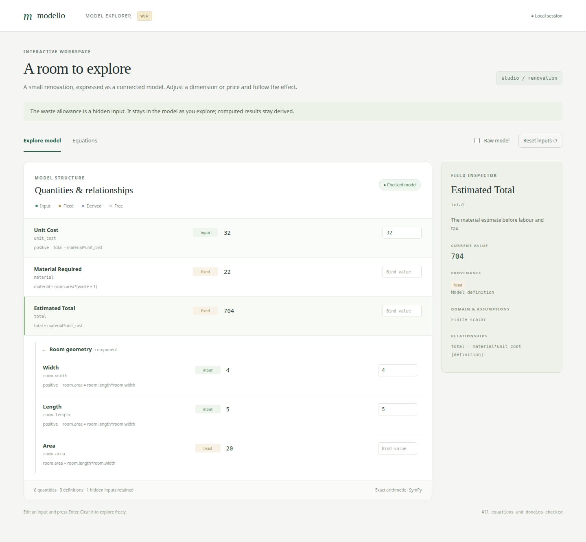
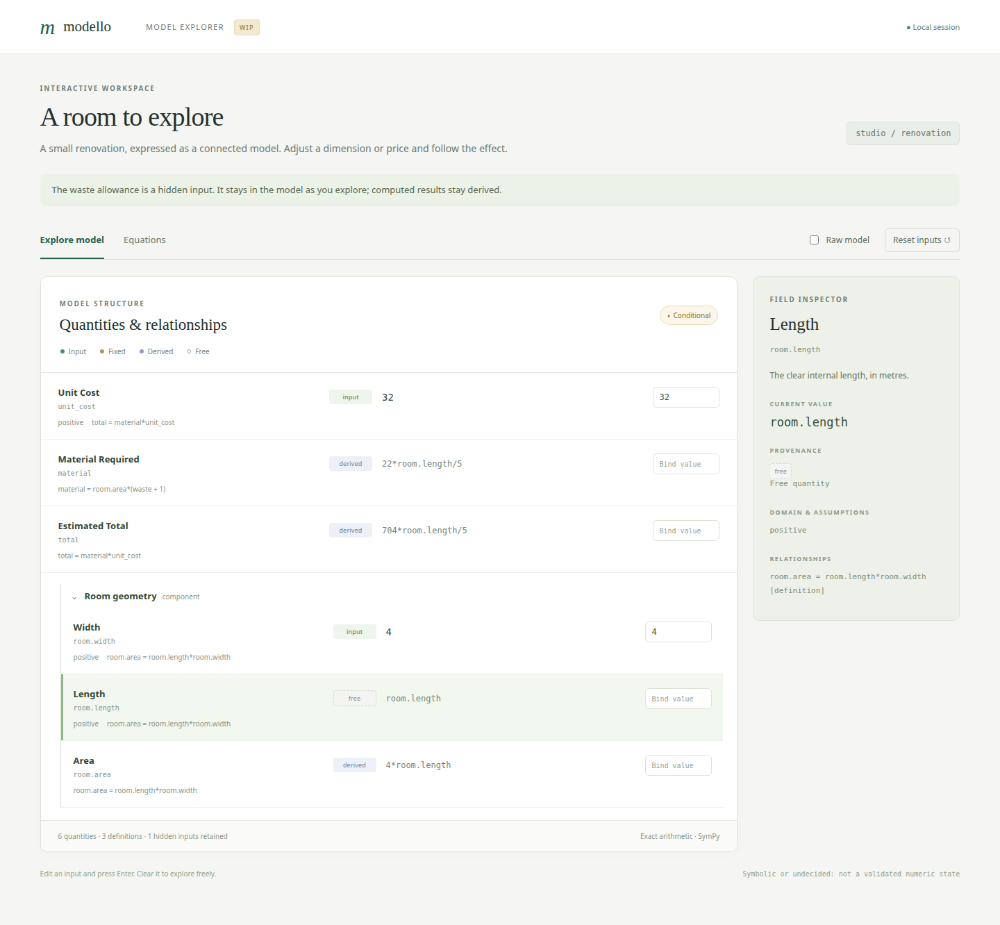

Interactive model explorer (WIP)
================================

The optional :mod:`modello.gui` module renders nested models in a local browser.
It is a prototype for exploring quantities, changing observations, and tracing
relationships. Install its separate extra; the base library still depends only
on SymPy:

.. code-block:: console

   $ pip install 'modello[gui]'
   $ python -m examples.gui

From a checkout, use ``uv run --extra gui python -m examples.gui``. Open
http://127.0.0.1:5058. The example models a room's geometry, material allowance,
and estimated cost. It uses exact numbers throughout.

Starting from your model
------------------------

``create_app`` accepts a model class, an existing instance, or a recorded
:class:`~modello.diagnostics.ModelProblem`. Initial ``inputs`` use full dotted
paths, including nested quantities:

.. code-block:: python

   from modello.gui import create_app
   from examples.gui import Studio
   from sympy import Rational

   app = create_app(
       Studio, "my renovation",
       inputs={"room.width": 4, "room.length": 5,
               "unit_cost": 32, "waste": Rational(1, 10)},
   )
   app.run(host="127.0.0.1", port=5058, debug=False)

With an instance, original supplied inputs are reopened as observations. Solved
outputs are recomputed when an input changes, rather than accidentally becoming
fixed observations. An overwritten instance field becomes an input, as with
component copies. The original instance is never changed. With a recorded
problem, all of its constraints are retained, including inferred observations
copied from a supplied component. Those copied results are fixed and have no
editor; editing a related input can therefore introduce a contradiction. Use
an instance to reopen its original inputs instead.

Edit a field and press Enter to apply an observation. Clear it and press Enter
to release the observation. You can also constrain an output and let the joint
model infer an input. Indentation and collapsible component headings retain
nested paths. The badges distinguish:

* **input**: an explicit supplied observation, including hidden inputs;
* **fixed**: a result that has become constant, or an inferred component
  observation retained from a recorded problem;
* **derived**: an expression in remaining symbolic quantities;
* **free**: an unbound quantity still represented by its own symbol.

Definitions, observations, and domain assumptions appear in quieter text and
in the inspector. The original constraint kinds remain available there, so a
fixed numeric result can still be traced to its definition. The inspector
names its source explicitly: supplied input, model definition, inferred value,
or copied component result. A fixed value is determined by the current
observations and can still change when inputs change. Aliases share an identity
and one editable observation across their alternate paths.

``Raw model`` shows definitions without invoking the solver. Existing inputs
remain identified in their editors and inspector. ``Reset inputs`` restores the
initial observations. Each browser holds its own edits; requests cannot change
another browser's state.

Descriptions, information, and hidden inputs
--------------------------------------------

Declare model-level text with ``ModelInfo`` and scalar or component labels
with ``FieldInfo``. Component classes supply their own declarations; a parent's
``fields`` and the ``metadata=`` argument can override labels by full dotted
path. Class docstrings provide default model and component descriptions.
Presentation metadata does not change the algebra:

.. code-block:: python

   from modello.gui import FieldInfo, ModelInfo

   # Inside a Modello class body:
   __gui__ = ModelInfo(
       title="Material estimate",
       description="A first estimate.",
       info="Prices exclude labour and tax.",
       fields={
           "room.width": FieldInfo(description="Clear internal width, in metres.",
                                   symbol="w"),
           "waste": FieldInfo(symbol="r", hidden=True),
       },
   )

Model-level labels are separate from field paths. The parent can set a
component's title with ``FieldInfo`` at that component path, while the
component's quantities retain their own descriptions. The complete declaration
and initial observations are shown in :mod:`examples.gui`.

A hidden field or component has no quantity row or editor. Its original inputs
remain in every solve, and the browser cannot replace or release them. Hidden
observation values are omitted from the browser response. Its symbol and
public description can still be explored in equations. This is a presentation
choice, not a secrecy boundary: calculated outputs can reveal input values.

Exact edits and validation
--------------------------

The browser accepts numbers and a small arithmetic language: ``+``, ``-``,
``*``, ``/``, ``**``, ``sqrt(...)``, ``pi``, ``E``, and ``I``. For example,
``1.25`` is the exact rational ``5/4``. Powers, literal size, arithmetic result
size, and expression length are bounded. Text is parsed with Python's syntax
tree without executing Python or SymPy expression strings. Arbitrary functions,
attribute access, and new external parameter names are not accepted in editors.
The trusted Python API accepts the usual symbolic scalar inputs.

A submitted value that violates a declared domain is rejected. The resulting
preview is also checked against the original equations and every field's
assumptions, including domains of derived quantities. The offending fields
are highlighted; the last successful results stay visible. Contradictions,
backend failures, and multiple surviving candidates block the edit. No arbitrary
branch or sampled point is chosen.

.. image:: _static/gui/validation.png
   :alt: A negative width is highlighted as an error while the previous valid cost remains visible.

A unique symbolic proposal is labelled **Conditional** when the existing
candidate audit cannot establish a fully checked numeric state. This includes
partially bound models and unresolved external parameters. It is an exploratory
preview, not a proof that every remaining parameter value is admissible.
Only a closed candidate satisfying every audit is labelled **Checked model**.
An empty solver answer is reported as failure to establish a preview, not as a
proof of inconsistency.

Equations and mobile exploration
--------------------------------

``Equations`` presents the original defining equations as a simultaneous
system using native presentation MathML. Inputs are not substituted into this
view. ``FieldInfo.symbol`` provides literal symbol text, including Unicode;
it is not interpreted as LaTeX. Symbols retain actual field identities even
when displayed names coincide. Hover, focus, or tap a symbol to see its full
path and description in a stable inspector. Keyboard users can tab between
symbols and press Enter or Space. On narrow screens, the inspector moves below
the equations rather than relying on a hover-only tooltip.

.. image:: _static/gui/equations.png
   :alt: Native MathML equations with a width symbol selected in the inspector.

.. image:: _static/gui/mobile.png
   :width: 320px
   :alt: Mobile layout with nested inputs and field details below the model.

Scope of this draft
-------------------

The interface serves bundled HTML, CSS, JavaScript, and MathML without a CDN or
JavaScript build step. The local Flask development server is intended for small,
trusted models on loopback. Symbolic work is synchronous: arithmetic limits are
not a solver timeout. There is no deployment, authentication, persistence,
multi-branch selection, or model-instance export flow in this draft. Browser
edits update the preview; they do not mutate the source Python model.

Construction and the preview share directed-definition expansion and candidate
generation. The preview applies the existing diagnostic audit, while ordinary
construction retains its original candidate filtering. Input parsing and MathML
printing are separate from the compiled presentation layout and HTTP adapter. Python
users can also call ``Explorer(...).snapshot(raw=True)`` for a solver-free,
JSON-ready view without installing Flask.

API
---

.. automodule:: modello.gui
   :members: ModelInfo, FieldInfo, Explorer, BindingError, create_app
