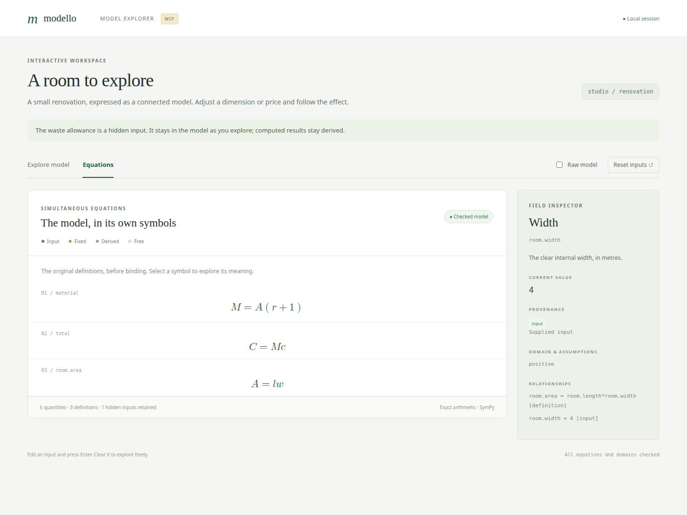
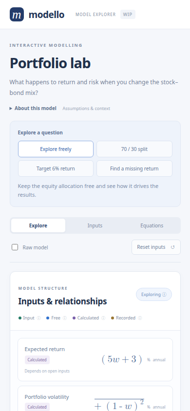
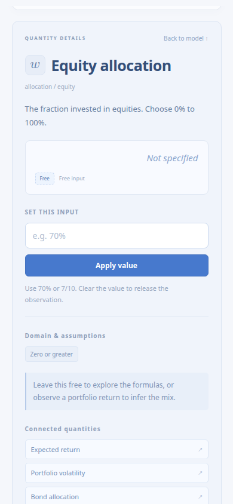
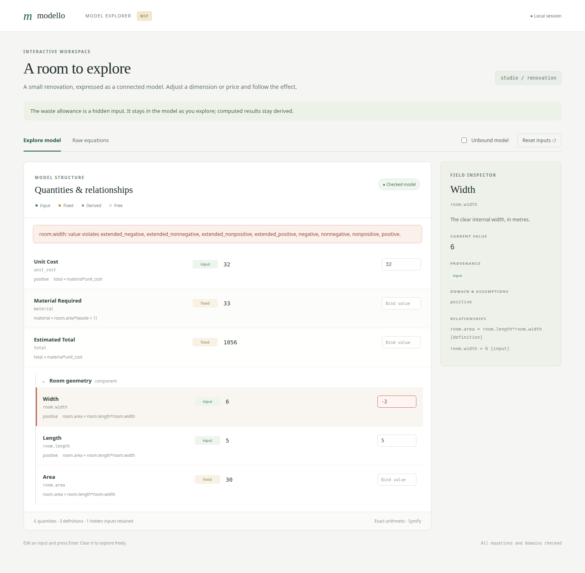

Interactive model explorer (WIP)
================================

The optional :mod:`modello.gui` module renders nested models in a local browser.
Install its separate extra; the base library still depends only on SymPy:

.. code-block:: console

   $ pip install 'modello[gui]'
   $ python -m examples.gallery

From a checkout, use ``uv run --extra gui python -m examples.gallery``. Open
http://127.0.0.1:5070. The :doc:`gallery <examples/gallery/index>` introduces
vectors, relative sequences, typed account models, calculus, and an Itô process.

Quickstart: your own explorer
------------------------------

Save this complete example as ``return_model.py`` and run
``python return_model.py`` after installing ``modello[gui]``. Open
http://127.0.0.1:5058. From a checkout, the same example runs with
``uv run --extra gui python -m examples.gui_quickstart``.

.. literalinclude:: ../examples/gui_quickstart.py
   :language: python
   :start-at: from sympy import Rational

Capital starts as a supplied input and expected return starts free. Choose
**8% return** to calculate USD 8,000 expected gain. Change capital to USD 200,000
to see gain update to USD 16,000. Drop the return input to explore the formula
again, or supply a gain instead to infer the required return.

Plain model declarations work without presentation metadata. Add ``gui`` where
labels, descriptions, symbols, or display formats help. ``@ModelInfo`` adds the
model's text and optional guided questions. Only serving the browser requires
the GUI extra; core annotations and Python snapshots work without Flask.

Choosing what you know
----------------------

An input is a supplied observation, not a permanent role assigned to a field.
You can change an original input, drop it, or supply a normally calculated
result as a target. Dropping an observation keeps the defining equations:
the quantity may become free, or it may be inferred from other observations.
Supplying a target adds an observation; it does not replace its equation or
silently discard conflicting inputs.

The **Inputs** view makes this choice explicit. Checked quantities are supplied;
unchecked quantities are left to the model. Edit values, uncheck assumptions,
or check a result and enter its target. **Apply inputs** validates all pending
changes together. The results continue to show the last applied case until
then. Rejected cases preserve both those results and the pending changes.
**Discard changes** returns the draft to the applied case without solving.
The apply controls stay visible while you scroll through pending changes.

The view distinguishes Original, Changed, Added, and Dropped inputs. Each row
shows its original supplied value when there was one. Its reset arrow restores
that quantity's original input state in the draft; it does not reset other
quantities. Aliases share one observation and one row. Hidden inputs remain
active and have no checkbox or editor.

Each guided question restores the initial observations before applying its
changes. Subsequent edits remain a custom exploration until you reset inputs.

Vectors and indexed formulas
------------------------------

The explorer recognises declared vectors automatically. Their symbols carry an
arrow, scalar coordinates use subscripts, and values appear as columns. Sums,
products, integrals, derivatives, and limits retain mathematical notation.
An indexed vector definition includes its iteration domain, for example
``for i ∈ {0, …, 4}``. Sum and product bounds are inclusive, like SymPy limits.

Choose **Inspect vector** to see its complete values, formula, connected
quantities, and individual entry sources. **Mixed** means its entries have
different sources, such as two observations and one inferred result; each entry
keeps its own Input, Free, Calculated, or Recorded label.

Supply an entire vector with ``[1, ?, 3/2]``. A ``?`` leaves that entry
unobserved, retaining its equation. Percentages are accepted per entry, such as
``[10%, ?, -2%]``. Applying a vector checks all entries together. Subsequent
individual edits compose with that proposal. **Drop observations** releases
the whole vector, and **Restore original input** restores its original
observation pattern. The **Inputs** view also supports changing coordinates
together with other model observations.

Whole-vector editing is available when all its coordinates can be edited.
Hidden entries are omitted from summaries and disable whole-vector editing;
Recorded entries retain their snapshot policy. Visible coordinates remain
independently inspectable. Vector metadata supplies default labels, units, and
number formatting to entries; explicit coordinate metadata replaces that
default. Python initial inputs and scenarios accept vectors or sequences at a
vector path, including nested paths such as ``"window.samples"``. The browser
uses bracketed coordinate paths such as ``"window.samples[2]"``.
An entry's **View in equations** action opens the complete indexed vector
definition, including when the entry was reached through an alias.

Understanding the interface
---------------------------

The colour key describes the **source** of a quantity, independently of whether
its current value is numeric or symbolic:

* **Input** is a supplied observation. It can be edited or released.
* **Free** is an open quantity still represented by its own symbol.
* **Calculated** follows from the model's equations. A numeric result stays
  calculated and updates when its inputs change. A result can also be observed
  as a target, making it an input instead.
* **Recorded** is a copied component result retained in a recorded problem.
  Its editor is disabled because that observation is held in the snapshot.

Hover or focus a colour key to read its explanation. Touch users can tap a key;
tap elsewhere or press Escape to dismiss it. The case-status key also explains
the distinction between a symbolic preview and a checked numerical case.
Colour is accompanied by text labels throughout.

The inspector shows descriptions, units, source, domain chips, mathematical
definitions, and links to connected quantities. Expressions use native MathML
instead of printed Python or diagnostic constraint lines. Open **View in
equations** for a definition that needs more room. Numeric displays use compact
rounded values; an approximation sign marks rounding, and **Exact value**
retains the underlying expression in the displayed units.

**Raw model** shows definitions without invoking the solver, retaining recorded
inputs in the editor. **Equations** shows the original defining equations before
observations are substituted. Hover, focus, or tap a symbol to inspect its path
and description. Tab, Enter, and Space support keyboard exploration.

On narrow screens the inspector moves below the model. Selecting a quantity
brings its details into view; **Back to model** returns to the quantities.
Tooltip placement is clamped to the viewport.

Starting from your model
------------------------

``create_app`` accepts a model class, an existing instance, or a recorded
:class:`~modello.diagnostics.ModelProblem`. Initial inputs use full dotted paths:

.. code-block:: python

   from modello.gui import create_app
   from examples.gui import Portfolio, DEMO_INPUTS

   app = create_app(Portfolio, "My portfolio", inputs=DEMO_INPUTS)
   app.run(host="127.0.0.1", port=5058, debug=False)

With an instance, original inputs are reopened as observations and solved
outputs are recomputed when inputs change. An overwritten instance field
becomes an input, as with component copies. The source instance is never
mutated. With a recorded problem, all its constraints remain, including
inferred component observations. Those are labelled Recorded and held fixed.
Reopen the instance when you want its outputs to recompute from original inputs.
Each browser holds its own edits and cannot change another browser's state.

Descriptions, units, and guided questions
-----------------------------------------

Place presentation beside a field with ``gui(field, *, ...)``, as in the
quickstart. All metadata arguments are keyword-only, including direct
``FieldInfo(...)``, ``ModelInfo(...)``, and ``Scenario(...)`` construction.
``gui`` accepts an ``InstanceDummy``, a calculated expression, or
``component(Child)``. Decorate the class with ``@ModelInfo(...)`` for model-level
text and guided questions.

Use ``gui`` around the **entire value assigned inside a Modello class body**:
``gain = gui(capital * expected_return, title="Expected gain")``. The class
namespace unwraps the declaration before later expressions use the field
normally. This declaration helper is not an arithmetic wrapper; putting
``gui(capital, ...)`` inside a larger calculation, or using its return value
outside that class scope, leaves the declaration uncollected.

Field metadata is a :class:`FieldInfo` annotation. The core collects it through
the general :class:`~modello.Annotation` mechanism; the solver never receives
GUI wrappers or metadata. Registry lookups are independent of Flask:

.. code-block:: python

   from modello.gui import FieldInfo

   info = ReturnModel.__modello_annotations__[FieldInfo]["expected_return"]
   assert info.title == "Expected return"
   # A typed helper for extension consumers:
   assert FieldInfo.for_model(ReturnModel)["expected_return"].symbol == "μ"
   assert ModelInfo.for_model(ReturnModel)[""].title == "Return model"

Nested annotation paths are scoped automatically, such as
``"market.equity.expected_return"``. Components retain their own declarations;
``gui(component(Child), ...)`` labels that component in its parent. Class
docstrings supply default model and component descriptions. Model classes and
component instance types are preserved. See :ref:`extension-annotations` for
writing other extensions using the same registry.

For models declared elsewhere, a ``ModelInfo(fields=...)`` mapping can override
presentation by relative dotted path. Application-level ``metadata=`` overrides
take priority over that mapping, followed by inline annotations. Each override
replaces the whole ``FieldInfo`` for that path. Model presentation uses the
annotation registry; ``__gui__`` blocks are rejected with a migration hint.
Presentation never changes the algebra.

``highlights`` makes selected quantities prominent as result cards.
``initial_field`` chooses the first inspector selection. A ``Scenario`` contains
trusted scalar observations and an optional field to select. Paths and edit
permissions are validated; a scenario cannot change hidden or Recorded values.
Its observations still pass through the same validation as manual edits.
Use ``None`` in a scenario's bindings to drop a specific initial observation;
other initial observations remain active.
Presentation paths are checked when constructing ``Explorer`` or ``create_app``,
before serving any requests. Errors name the offending option or scenario,
include the full nested path, and suggest similar field names when available.
For example, a misspelt ``Scenario(title="Target", ...,
select="expected_retrn")`` reports ``Scenario 'Target'.select`` and suggests
``'expected_return'``. Initial input paths and snapshot bindings use the same
path checks. A scenario targeting hidden or Recorded data explains why the
quantity cannot be edited.

Repeating ``gui`` metadata on the same field or
``ModelInfo`` on the same class raises ``ModelDefinitionError``; subclasses
can explicitly refine inherited presentation in their own declaration scope.

``symbol`` is literal text, including Unicode, rather than LaTeX. ``unit`` is a
display label without automatic unit conversion or dimensional analysis.
``number_format="percent"`` displays fractional values in percent and seeds
the editor with percentage notation. Numeric summaries do not change exact
values or loosen validation.

A hidden field or component has no row or editor. Its original inputs remain
in every solve, and the browser cannot replace or release them, including
through aliases. Hidden observation values are omitted from the browser
response; their public symbols and descriptions remain inspectable in formulas.
This is presentation rather than a secrecy boundary: derived outputs and
public model notes can reveal inputs.

Exact edits and validation
--------------------------

Editors accept numbers, ``+``, ``-``, ``*``, ``/``, ``**``, ``sqrt(...)``, ``pi``,
``E``, and ``I``. A trailing ``%`` divides the whole expression by 100:
``70%`` and ``7/10`` are the same exact value. ``1.25`` is exactly ``5/4``.
Input length, literal and arithmetic sizes, and powers are bounded. The parser
uses Python's syntax tree without evaluating Python or SymPy expression strings.
Arbitrary functions, attribute access, and new parameter names are not accepted.
The trusted Python API continues to accept normal symbolic scalar inputs.

Vector and request budgets scale with the declared, trusted model shape; each
entry retains the scalar arithmetic limits. Accepted input expressions are kept
as editor text, even when their exact values expand to much longer fractions or
integers. This lets a later coordinate edit reuse the applied proposal without
turning an accepted expression into an oversized literal.

The proposed case is checked against original equations and all declared
assumptions, including domains of calculated and hidden quantities. Invalid
edits identify both the edited fields and any derived domain failures, while
retaining the last successful model. No arbitrary branch or sampled point is
chosen when several solutions remain.

A unique symbolic proposal is labelled **Exploring** when its audit cannot
establish a fully checked numeric case. This includes partially bound models
and unresolved external parameters. It is not a claim that every remaining
parameter value is admissible. **Checked case** requires a closed candidate
satisfying every audit. Failure to produce a solver candidate is reported as
failure to validate a case, not as proof of inconsistency.

Scope of this draft
-------------------

The interface serves bundled HTML, CSS, JavaScript, MathML, and the STIX Two Math
font without a CDN or
JavaScript build. The local Flask server is intended for small trusted models
on loopback. Symbolic work is synchronous; arithmetic limits are not a solver
timeout. There is no deployment, authentication, persistence, multi-branch
selection, or model-instance export flow.

Construction and the preview share directed-definition expansion and candidate
generation. The preview uses the diagnostic audit while construction retains
its original filtering. Python users can call ``Explorer(...).snapshot(raw=True)``
for a solver-free, JSON-ready view without installing Flask. Snapshot ``kind``
uses ``derived`` for both numeric and symbolic calculations and ``fixed`` only
for recorded component observations; ``value_state`` describes the display form.
Each visible field also reports ``initial_input`` and an ``input_state`` of
``initial``, ``overridden``, ``added``, ``dropped``, or ``unspecified``. This input
history is independent of whether the current value is free or calculated.
Hidden fields omit original values and report ``input_state="hidden"``.

Python snapshots are stateless proposals against the initial observations:
``snapshot({"height": 6})`` overrides height, and ``snapshot({"height": None})``
drops it. Omitting height from the next proposal restores its original state.
Pass all desired overrides and drops together in one mapping. The browser
retains this mapping between edits and removes a field's override when you
restore it individually.

Typed model vectors
-------------------

The :doc:`account gallery model <model-vectors>` nests typed executions and
account states under their vectors. Add or remove executions, inspect a member,
and edit its quantities. The source recurrence appears once; calculated fields
link back to it. Patterns such as ``fills[]`` and ``fills[].price`` provide
member labels and indexed symbols.

``ExplorerValue`` covers scalar, vector, and model-vector observations. For the
Python API, ``ModelVectorInput`` supplies ordered records such as
``{"fills": [{"quantity": 2, "price": 100, "fee": 1}]}`` alongside scalar
paths such as ``"states[0].cash"``. Record length determines the window.

Mathematical rendering
----------------------

Native MathML renders vector arrows, subscripts, Σ/Π/∫, and stretchy brackets
using the locally bundled STIX Two Math font. Expectation, variance, and the
process generator use 𝔼, 𝕍, and ℒ. LaTeX export uses the corresponding
mathematical alphabets. Font attribution and its SIL Open Font License are
bundled under ``modello/_gui/static/fonts/``.

API
---

.. automodule:: modello.gui
   :members: gui, ModelInfo, FieldInfo, Scenario, Explorer, BindingError, create_app
